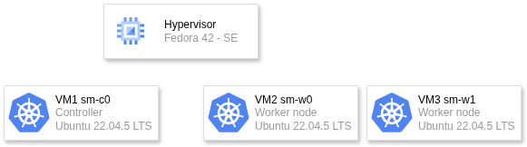

# Kubernetes Cluster Security Hardening: Google Microservices Demo

## 1. Introduction


## Table of Contents

1.  [Introduction](#1-introduction)
2.  [Cluster Overview](#2-cluster-overview)
3.  [Application Deployment: Google Microservices Demo](#3-application-deployment-google-microservices-demo)
4.  [**Security Hardening Measures**](#4-security-hardening-measures)
    - [4.1 Network Security & Policies](#43-network-security--policies)
    - [4.2 Role-Based Access Control (RBAC)](#44-role-based-access-control-rbac)
    - [4.3 Secrets Management](#45-secrets-management)
    - [4.4 Container Image Security](#46-container-image-security)

5.  [How to Deploy / Recreate](#6-how-to-deploy--recreate)

---

## 2. Cluster Overview
  


This section details infrastructure of Kubernetes cluster.

| Attribute              | Value                             | Notes                                                        |
| ---------------------- | --------------------------------- | ------------------------------------------------------------ |
| **Hypervisor OS**      | Fedora 42 (Server Edition)        |                                                              |
| **Node OS**            | Ubuntu 22.04.5 LTS                |                              |
| **Number of Nodes**    | 3 nodes: 1 Controller, 2 Workers  |                                                              |
| **CNI Plugin**         | alico|  |

| Component | Hostname   | OS                         | Role          |
| --------- | ---------- | -------------------------- | ------------- |
| Host      | hypervisor | Fedora 42 (Server Edition) | Hypervisor    |
| VM 1      | sm-c0      | Ubuntu 22.04.5 LTS         | Control Plane |
| VM 2      | sm-w0      | Ubuntu 22.04.5 LTS         | Worker Node   |
| VM 3      | sm-w1      | Ubuntu 22.04.5 LTS         | Worker Node   |

---

## 3. Application Deployment: Google Microservices Demo

The cluster hosts the [Google Microservices Demo](https://github.com/GoogleCloudPlatform/microservices-demo), a sample cloud-native application.

*   **Deployment Method**: Deployed using kubectl apply -f ./release/kubernetes-manifests.yaml
*   **Namespace**: The application is deployed in the **default** namespace
---

## 4. Security Hardening Measures

The following security controls have been implemented across the cluster.

### 4.1 Network Security & Policies /TODO/

### 4.2 Role-Based Access Control (RBAC) /TODO/

### 4.3 Pod Security Context Hardening
Strict security rules have been applied in Pod Security Context all application pods using a Kustomize patch. This ensures that applications run safely and with limited permissions. The main rules are:
- **`runAsNonRoot: true` & `runAsUser: 1001`** Containers are prevented from running as the "root" user. A standard, less priviliged user account (ID 1001) is used instead.
- *`readOnlyRootFilesystem: true`** The main file system inside each container is set to "read-only." This stops any unauthorized changes to important application files.
- **`allowPrivilegeEscalation: false`** -The ability for a process to gain more permissions than it started with has been disabled.
- **`capabilities: drop: ["ALL"]`**  Removes all Linux capabilities, significantly reducing the kernel-level attack surface. Processes uses only the minimal set of capabilities needed to run.
- **`seccompProfile: { type: RuntimeDefault }`**: Applies the default secure computing (seccomp) profile of the container runtime, which blocks potentially dangerous syscalls.

### 4.4 Container Image Security /TODO/

---

## 5. How to Deploy 


### Prerequisites

* AMD64 VMs with Unix OS, at least 1 Controller and 1 Worker
* Ansible with XXXXXXXXX version 
### Deployment Steps

1.  **Node preparation**:
    Go to each pod and run ansible initialization task on it, prepare inventory file based on your infrastructure 
    ```bash
	ansible-playbook -i inventory.ini initial_configuration.yaml
    ```
2.  **Initialize kubernetes cluster**:
    ```bash
    # On Controller
    sudo kubeadm init --pod-network-cidr=<own_cidr>
    mkdir -p $HOME/.kube
	sudo cp -i /etc/kubernetes/admin.conf $HOME/.kube/config
	sudo chown $(id -u):$(id -g) $HOME/.kube/config
    
    # On Workers:
    # Run join commands based on kubeadm init output  
    ```
3. **Apply CNI on controller**
   ```bash
	kubectl apply -f https://raw.githubusercontent.com/projectcalico/calico/v3.26.0/manifests/calico.yaml
    ```
5. **Deploy Application**:
    ```bash
    # Navigate to the manifests directory
    cd microservices-demo/
    kubectl apply -f ./release/kubernetes-manifests.yaml
    ```
6.  **Apply Security Policies**:
    ```bash
    kubectl apply -f ./network-policies/
    ```
7.  **Apply RBAC /IN PROGRESS/:
    ```bash
    kubectl apply -f ./RBAC/
    ```
---

